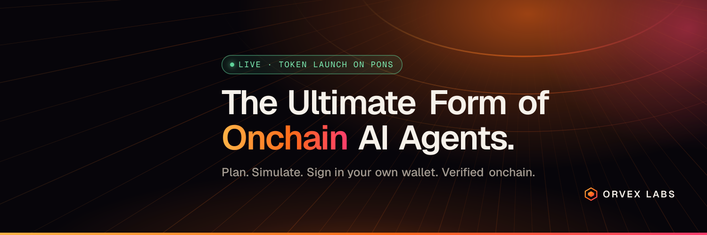

<p align="center">
  
</p>

<h1 align="center">Orvex Labs</h1>

<p align="center">
  <b>The ultimate form of onchain AI agents.</b><br>
  Agents that plan, simulate and execute onchain. You sign in your own wallet. Every run ends with proof.
</p>

<p align="center">
  <a href="https://orvexlabs.xyz"><b>orvexlabs.xyz</b></a> ·
  <a href="https://x.com/OrvexLabsxyz">X / @OrvexLabsxyz</a> ·
  <a href="https://orvexlabs.xyz/launch">Launch app</a>
</p>

---

## What is Orvex?

Most AI tools for crypto stop at advice. You still copy addresses, fill in forms and hope the transaction does what you meant.

Orvex closes that gap. You describe what you want in one sentence. An agent plans it, checks it against live chain data, **simulates the exact transaction**, and hands it to you to **sign in your own wallet**. After you sign, Orvex verifies the result onchain and publishes a replay of every step, so anyone can check what happened.

## Agents

| Agent | Status |
|---|---|
| **Token Launch on Pons:** launch a token on Pons (Robinhood Chain) from one sentence, with a dry-run, your own signature and an onchain-verified receipt | 🟢 **LIVE** |
| **Smart Contract Deployment:** shape, check and deploy contracts with traceable proof | ⏳ Coming soon |
| **Sniper War Room:** coordinate launch timing, pools, announcements and monitoring | ⏳ Coming soon |
| **Presale Fair Launch:** sale rules, whitelists, caps, vesting and claim pages | ⏳ Coming soon |
| **Liquidity & Trust:** LP and team locks, vesting, renouncement | ⏳ Coming soon |
| **Airdrop Claim Multisender:** clean lists, batch sends, claim pages and receipts | ⏳ Coming soon |
| **Post-Launch Console:** watch price, liquidity and holders, then act by rule | ⏳ Coming soon |
| **Meme-to-Market Assets:** mascot, metadata, website and promo assets from one idea | ⏳ Coming soon |
| **x402 Endpoint Builder:** turn an API into a paid x402 endpoint with docs and proof | ⏳ Coming soon |

Agents switch to LIVE only when they actually work.

## How a launch works

```
 You            Orvex agent                     Robinhood Chain / Pons
  │  "Launch Ember, ticker EMBR"  │                          │
  │ ─────────────────────────────▶│  check launch details    │
  │                               │  read gas, balance, fee ─┼──▶ live chain data
  │                               │  dry-run exact tx ───────┼──▶ simulation
  │◀───────── plan to review ─────│                          │
  │  sign in your own wallet ─────┼──────────────────────────┼──▶ transaction
  │                               │  verify result onchain ◀─┤
  │◀── receipt + public replay ───│                          │
```

1. **Describe:** name, ticker, description, links, logo. An initial buy is optional.
2. **Check & simulate:** the agent reads Pons and Robinhood Chain live and dry-runs the exact transaction from your wallet: token address, costs and tokens from any initial buy are known up front.
3. **Sign:** you review every number and sign in your own wallet.
4. **Verify:** Orvex checks sender, contract, calldata, ETH amount and the new token against the plan, then publishes a replay.

## Principles

- **Your keys stay yours.** Orvex never holds private keys and cannot send transactions. The agent only proposes.
- **Simulate before you spend.** Every transaction is dry-run against live chain state before you are asked to approve it.
- **Proof, not promises.** Results are verified onchain and published as replays, not screenshots.
- **Ship in public.** Capabilities are marked LIVE only when they work.

## Built with

Robinhood Chain · Pons Launchpad · Claude (Anthropic) · IPFS · Uniswap v4 · your own wallet

## Links

- 🌐 Website: [orvexlabs.xyz](https://orvexlabs.xyz)
- 🚀 App: [orvexlabs.xyz/launch](https://orvexlabs.xyz/launch)
- 𝕏 X: [@OrvexLabsxyz](https://x.com/OrvexLabsxyz)
- 📄 [Terms](https://orvexlabs.xyz/terms) · [Privacy](https://orvexlabs.xyz/privacy)

> The Orvex application source code is private while the product is in active development.
> Launching a token on mainnet spends real ETH and tokens can lose all value. Nothing here is financial advice.

<p align="center"></p>
